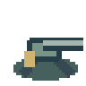
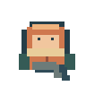

# 户外座位与固定武器

[返回项目首页](../../README.md) · [手册目录](../README.md) · [本组目录](README.md)

这些是自然空地区块中的固定设施，不是箱内物品，也不能制作、搬走、拆除或补充库存。地面可以通行，不阻挡视线或子弹；同一格最多一人使用座位，其他玩家可以走过但不能同时坐下。普通容器和交易机器见[设施手册](machines.md)。

## 公园椅子

- **名称与标识**：公园椅子 / Park bench / `park_bench`。
- **获取方式**：每个自然空地区块独立2%概率生成1个，随机落在区块内部空位，不在建筑/林地区块生成。
- **效果与数值**：纯休息与社交座位，没有恢复、保温、无敌或免费产出；同一时间只允许一个玩家坐着。
- **操作方式**：2格内可见时左键点击，手机点座位或使用按钮；再次点击自己使用的座位或开始行走即可起身。
- **消耗与限制**：不可拆除、不能作为背包物品；坐着仍能受到全部正常伤害。受击会起身并按碰撞规则击退，有空间时离开座位格，不会因坐下规避饥饿或体温结算。

## 固定机枪

- **名称与标识**：固定机枪 / Mounted machine gun / `mounted_gun`。
- **获取方式**：每个自然空地区块独立1%概率生成1个，与公园椅子及其他生成判定互不影响；两者同时出现时不重叠。
- **效果与数值**：初始5000发，无限库存与补弹均不提供。子弹与步枪一致：单发5伤害，最短射击间隔0.15秒，弹速28格/秒；穿透、射程、友伤及警长徽章规则沿用步枪。
- **操作方式**：2格内可见时点击坐上，附近欧氏距离≤2格有任何怪物时不能上座，包括休眠怪物；坐上后鼠标瞄准并长按左键连射，手机用瞄准摇杆和长按使用按钮。无需手持枪械，空物品栏也可射击。开始行走即可离开。
- **消耗与限制**：同一时间仅一人操作。占座时免疫大怪已发射的远程子弹，不免疫玩家子弹、近战或其他伤害；受到有效伤害后立即停止射击并被推下。5000发耗尽后仍可坐下，但不能再开火。不可拆除，不可搬运、装填或通过重连/重启恢复弹药。已有机枪保留存档中的剩余弹药，尚未生成的区块使用5000发初始弹药。

## 坐姿与离线

 

玩家具有上下左右四向坐姿；固定机枪使用八方向PNG随瞄准旋转，方向跟随本地输入，不等待网络往返。移动立即退出坐姿，受击退出由服务器权威结算。使用其他手持物品时仍遵守原有规则，没有坐姿专属免耗品效果。

退出、断线或服务器重启释放占座。再次登录时不自动坐回去，角色放在距离上次位置最近的可落脚空地格，木地板与地雷可落脚，其他座位格不作为自动重连落点。普通玩家上次位置被墙、树、其他实体等占用时也使用最近可落脚格修正；不会清除建筑来安置角色。

## 保存与旧世界

设施位置和剩余弹药保存在SQLite，占座是在线运行状态，不写入持久玩家背包。弹药扣除、冷却和生成子弹一起原子保存；保存失败整次回退。已生成区块不补刷设施，旧存档的未探索空地区块使用当前独立随机流生成，保存重启后不重复抽取。
