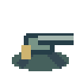

# 户外座位与固定武器

[返回项目首页](../../README.md) · [手册目录](../README.md) · [本组目录](README.md)

这些是自然生成的固定设施，不能制作、搬走或拆除。地面可以通行，不阻挡视线或子弹；同一格最多一人使用座位，其他玩家可以走过但不能同时坐下。普通容器和交易机器见[设施手册](machines.md)。

## 公园椅子

- **名称与标识**：公园椅子 / Park bench / `park_bench`。
- **获取方式**：每个自然空地区块独立2%概率生成1个，随机落在区块内部空位，不在建筑/林地区块生成。
- **效果与数值**：纯休息与社交座位，没有恢复、保温、无敌或免费产出；同一时间只允许一个玩家坐着。
- **操作方式**：2格内可见时左键点击，手机点座位或使用按钮；再次点击自己使用的座位或开始行走即可起身。
- **消耗与限制**：不可拆除、不能作为背包物品；坐着仍能受到全部正常伤害。受击会起身并按碰撞规则击退，有空间时离开座位格，不会因坐下规避饥饿或体温结算。

## 固定机枪

- **名称与标识**：固定机枪 / Mounted machine gun / `mounted_gun`。
- **获取方式**：每个自然空地区块独立 0.5% 概率生成 1 个，与公园椅子及其他生成判定互不影响。两者同时出现时各占独立位置。
- **效果与数值**：新生成时有 80 发。每发 5 伤害，最短射击间隔 0.15 秒，弹速 28 格/秒。子弹可穿透怪物，普通树、木墙、闭门分别承受 12、24、16 发后摧毁，栅栏透弹。
- **操作方式**：2格内可见时点击坐上，附近欧氏距离≤2格有任何怪物时不能上座，包括休眠怪物；坐上后鼠标瞄准并长按左键连射，手机用瞄准摇杆和长按使用按钮。无需手持枪械，空物品栏也可射击。开始行走即可离开。
- **消耗与限制**：同一时间仅一人操作。占座时免疫大怪已发射的远程子弹；受到有效伤害后立即停火并被推下。按 R 或触屏“装填”可在 2 秒内加入整包 8 发步枪弹，每台合计最多额外装 24 发。剩余弹量与补弹次数随存档保留。

## 待维修机枪

机枪固定在自然生成的位置。选中有耐久的扳手，点击两格内的机枪可维修。一次扣 5 个零件与 1 次扳手耐久，零件是过湖主桥 10 个需修桥墩的一半。随后需用整包步枪弹装填。它与完好固定机枪共用射速、伤害、贯穿和补弹上限。操作席仍会受到怪物远程弹伤害。存档保留弹药和维修状态。

## 坐姿与离线

 

玩家具有上下左右四向坐姿；固定机枪使用八方向PNG随瞄准旋转，方向跟随本地输入，不等待网络往返。移动立即退出坐姿，受击退出由服务器权威结算。使用其他手持物品时仍遵守原有规则，没有坐姿专属免耗品效果。

退出、断线或服务器重启释放占座。再次登录时不自动坐回去，角色放在距离上次位置最近的可落脚空地格，木地板与地雷可落脚，其他座位格不作为自动重连落点。普通玩家上次位置被墙、树、其他实体等占用时也使用最近可落脚格修正；不会清除建筑来安置角色。
