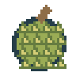

# 雪原扩展物品图鉴

[返回项目首页](../README.md) · [手册目录](README.md)

本次设计新增20食品、20武器、20道具；它们各自使用独立命名随机流，在每个新生成的自然房屋箱子里判定一次，概率为0.1%～2%，可以同时出现。榴莲与榴莲皮、追踪导弹属于另外的独立需求，不计入这60种。

## 平衡与通用规则

食品的小份即食物较常见，需火的大份餐食较稀有；食品仍只能在饥饿不大于10时吃，但一次进食可超过10。新增武器全都有弹药、次数或一次性限制，没有无限武器，也没有新增装填/复制配方或机器购买途径。强力范围、冰冻、灼烧和回城物品概率更低。

枪械间隔受服务器冷却与每tick最多一枪共同限制；新自动枪也不能因低帧率补发。近战每次有效挥动含空挥耗一次，冷却内点击不扣次数。新投掷物不伤玩家或建筑。警长徽章仍只对小怪/快速怪乘2，同一状态不叠加，只取更晚结束时刻。

所有被动同属性只取最好的一件，不叠加；不同属性可共存。手持装备必须选中才生效，不能与迅捷戒指同时选中叠加。医疗补给饥饿只补至10，保留已有超额值；食品则完整加值。新工具不新增离线消耗。

体温与饥饿仍是原有生存系统，没有额外生命值。每件物品的说明卡同时提供中英文效果和用法。武器与工具耗尽消失；转移、消耗、产出、状态和命中沿用原子存档。

## 20种食品

| 名称 / English / ID | 独立概率 | 效果 | 操作 |
| --- | --- | --- | --- |
|  巧克力 / Chocolate bar / `chocolate_bar` | 1.8% | 恢复2点饥饿，可超过10。 | 选中后长按0.5秒吃掉；不需要篝火。饥饿大于10时不能吃，手机按住使用。 |
|  能量棒 / Energy bar / `energy_bar` | 1.2% | 恢复3点饥饿，可超过10。 | 选中后长按0.5秒吃掉；不需要篝火。饥饿大于10时不能吃，手机按住使用。 |
|  花生米 / Roasted peanuts / `peanut_pack` | 1.5% | 恢复2.5点饥饿，可超过10。 | 选中后长按0.5秒吃掉；不需要篝火。饥饿大于10时不能吃，手机按住使用。 |
|  芒果干 / Dried mango / `dried_mango` | 1.8% | 恢复1.5点饥饿，可超过10。 | 选中后长按0.5秒吃掉；不需要篝火。饥饿大于10时不能吃，手机按住使用。 |
|  牛肉干 / Beef jerky / `beef_jerky` | 1% | 恢复3.5点饥饿，可超过10。 | 选中后长按0.5秒吃掉；不需要篝火。饥饿大于10时不能吃，手机按住使用。 |
|  黄桃罐头 / Canned peaches / `canned_peaches` | 1.5% | 恢复2点饥饿，可超过10。 | 选中后长按0.5秒吃掉；不需要篝火。饥饿大于10时不能吃，手机按住使用。 |
|  焗豆罐头 / Canned beans / `canned_beans` | 1% | 恢复3.5点饥饿，可超过10。 | 选中后长按0.5秒吃掉；不需要篝火。饥饿大于10时不能吃，手机按住使用。 |
|  玉米罐头 / Canned corn / `canned_corn` | 1.5% | 恢复2.5点饥饿，可超过10。 | 选中后长按0.5秒吃掉；不需要篝火。饥饿大于10时不能吃，手机按住使用。 |
|  菠萝罐头 / Canned pineapple / `canned_pineapple` | 1.6% | 恢复2点饥饿，可超过10。 | 选中后长按0.5秒吃掉；不需要篝火。饥饿大于10时不能吃，手机按住使用。 |
|  芝麻饼 / Sesame biscuit / `sesame_biscuit` | 1.8% | 恢复2点饥饿，可超过10。 | 选中后长按0.5秒吃掉；不需要篝火。饥饿大于10时不能吃，手机按住使用。 |
|  米饼 / Rice cracker / `rice_cracker` | 2% | 恢复1点饥饿，可超过10。 | 选中后长按0.5秒吃掉；不需要篝火。饥饿大于10时不能吃，手机按住使用。 |
|  蜂蜜包 / Honey sachet / `honey_sachet` | 1.8% | 恢复1.5点饥饿，可超过10。 | 选中后长按0.5秒吃掉；不需要篝火。饥饿大于10时不能吃，手机按住使用。 |
|  混合坚果 / Mixed nuts / `mixed_nuts` | 1.2% | 恢复3点饥饿，可超过10。 | 选中后长按0.5秒吃掉；不需要篝火。饥饿大于10时不能吃，手机按住使用。 |
|  海苔卷 / Seaweed roll / `seaweed_roll` | 1.7% | 恢复1.5点饥饿，可超过10。 | 选中后长按0.5秒吃掉；不需要篝火。饥饿大于10时不能吃，手机按住使用。 |
|  小鱼干 / Dried fish / `dried_fish` | 1.2% | 恢复2.5点饥饿，可超过10。 | 选中后长按0.5秒吃掉；不需要篝火。饥饿大于10时不能吃，手机按住使用。 |
|  冷冻披萨 / Frozen pizza / `frozen_pizza` | 0.6% | 恢复5点饥饿，可超过10。 | 选中后长按0.5秒吃掉；需要燃烧篝火曼哈顿距离1至3格。饥饿大于10时不能吃，手机按住使用。 |
|  咖喱饭 / Curry rice / `curry_rice` | 0.5% | 恢复5.5点饥饿，可超过10。 | 选中后长按0.5秒吃掉；需要燃烧篝火曼哈顿距离1至3格。饥饿大于10时不能吃，手机按住使用。 |
|  燕麦粥 / Oatmeal / `oatmeal` | 0.8% | 恢复4.5点饥饿，可超过10。 | 选中后长按0.5秒吃掉；需要燃烧篝火曼哈顿距离1至3格。饥饿大于10时不能吃，手机按住使用。 |
|  蘑菇汤 / Mushroom soup / `mushroom_soup` | 0.9% | 恢复4点饥饿，可超过10。 | 选中后长按0.5秒吃掉；需要燃烧篝火曼哈顿距离1至3格。饥饿大于10时不能吃，手机按住使用。 |
|  八宝粽 / Festival rice dumpling / `festival_dumpling` | 0.3% | 恢复6点饥饿，可超过10。 | 选中后长按0.5秒吃掉；需要燃烧篝火曼哈顿距离1至3格。饥饿大于10时不能吃，手机按住使用。 |

## 20种武器

二十种有限武器的立绘、概率、伤害、弹药次数和操作统一收录在独立的[武器手册](weapons.md#二十种扩展武器)，此处不重复维护武器表。

## 20种道具

| 名称 / English / ID | 独立概率 | 效果 | 操作 |
| --- | --- | --- | --- |
|  羊毛围巾 / Wool scarf / `wool_scarf` | 1.8% | 携带时体感温度增加3°C，不直接增加体温；同类保暖只取最高值。 | 放在背包或物品栏即生效，不用选中；不消耗，多件不叠加。亢奋时仍固定体感30°C。 |
|  羽绒服 / Down coat / `down_coat` | 0.5% | 携带时体感温度增加6°C，同类只取最高值；仍可能失温。 | 放背包或物品栏即生效，不用选中；不消耗，多件不叠加。亢奋时固定30°C。 |
|  雪地靴 / Snow boots / `snow_boots` | 1.2% | 选中时当前体温/饥饿下移速乘1.5，倒地仍不能移动。 | 必须放在物品栏并选中；切换即失效，不消耗，不与其他手持加速叠加。 |
|  登山手杖 / Hiking cane / `hiking_cane` | 0.6% | 选中时当前移速乘1.8，不会取消饥饿与失温惩罚；不能攻击。 | 放物品栏并选中；未选中无效，倒地无效，不消耗、不叠加。 |
|  口袋暖炉 / Pocket warmer / `pocket_stove` | 1% | 每次恢复12°C体温，上限36°C；不改变饥饿，初始3次。 | 选中后长按0.5秒；手机按住使用，无需篝火，倒地也能用。耗尽消失。 |
|  保温壶 / Warming flask / `warming_flask` | 0.8% | 每次恢复18°C体温，上限36°C；饥饿不变，初始2次。 | 选中后长按0.7秒，无需火，倒地可用；手机按住使用，耗尽消失。 |
|  保温毯 / Thermal blanket / `thermal_blanket` | 0.9% | 一次性恢复36°C满体温，不改变饥饿。 | 选中后长按1秒，无需火，倒地也能用；手机按住使用。 |
|  葡萄糖补给 / Glucose vial / `glucose_vial` | 1.4% | 一次性补充3点饥饿，最多补至10，不降低已有超额饥饿，体温不变。 | 选中后长按0.5秒，无需火，倒地也能用；它是恢复用品，不是可超额进食的食品。 |
|  野外补给袋 / Field supply pouch / `field_supply` | 0.6% | 初始2次，每次恢复8°C体温和最多2点饥饿，分别补至36°C/10；保留超额饥饿。 | 选中长按1秒，无需火，倒地可用；手机按住使用，耗尽消失。 |
|  复苏针 / Revival syringe / `revival_syringe` | 0.4% | 一次性救起1格内倒地队友，恢复36°C与至少10饥饿。 | 对准倒地的其他在线玩家长按3秒，视线须畅通。手机可长按该玩家或瞄准后按住使用；不能自救。 |
|  救援信标 / Rescue beacon / `rescue_beacon` | 0.2% | 一次性回到原点附近最近可站立空地，地板可落脚，等距优先远离怪物。 | 选中长按2.5秒；手机按住使用，无需火，倒地可用；成功后消失。 |
|  裂纹回城石 / Cracked return stone / `return_stone` | 0.1% | 初始3次，使用回城法杖相同落点规则。 | 选中长按2秒；无需火，倒地可用，手机按住使用；耗尽消失。 |
|  防风火种 / Storm lighter / `storm_lighter` | 0.8% | 可点燃篝火10次，每次仍需1木材，不延长燃烧时间。 | 打开篝火，放入火种格与木材后点燃；不能手持直接点火，耗尽消失。 |
|  引火棒 / Firestarter rod / `firestarter` | 1.8% | 提供3次篝火点火，其他燃烧规则不变。 | 放入篝火火种格并备木材，再点燃；每次耗一格次数，用完消失。 |
|  火绒盒 / Tinder box / `tinder_box` | 1% | 提供8次篝火点火，不代替木材燃料。 | 放进篝火火种格并添加木材，通过窗口点燃，用完消失。 |
|  护甲片 / Armor plate / `armor_plate` | 0.4% | 携带时怪物命中造成的体温和饥饿损失减少20%；不减寒冷或自然饥饿，不减玩家枪伤。 | 放背包或物品栏即生效，不用选中、不消耗，多件只取最强，不叠加。 |
|  安全头盔 / Safety helmet / `safety_helmet` | 1% | 携带时怪物造成的击退距离减少25%，不减少伤害，不改变玩家枪击击退。 | 放背包或物品栏即生效，不用选中、不消耗、多件不叠加。 |
|  拾荒手套 / Scavenger glove / `collector_glove` | 0.7% | 携带时自动拾取半径从0.75米增至1.1米；仍要求背包有空格、视线畅通。 | 放背包或物品栏即生效，不消耗、多件不叠加；硬币仍直接计入金钱。 |
|  保鲜饭盒 / Insulated lunchbox / `insulated_lunchbox` | 0.6% | 携带时自然饥饿消耗降低20%，不降低受击损失，不增加食品回复值。 | 放背包或物品栏即生效，不消耗、多件不叠加；离线仍不消耗饥饿。 |
|  燃料补给包 / Fuel supply pack / `fuel_pack` | 1.2% | 一次性拆出5木材，优先放背包，再放物品栏，不改变饥饿或体温。 | 选中长按1秒，无需火；需要含补给包原格在内至少5个空格，不足时不消耗、不产出。手机按住使用。 |

## 榴莲与榴莲皮

 

榴莲 `durian` 在新自然房屋箱子中独立有3%概率生成，无需篝火，长按0.5秒食用恢复3饥饿。等于10时仍能吃到13，大于10时不能吃。成功食用后，同一个物品栏格子被一个新的 `durian_peel` 榴莲皮替换；不另找空格，满背包也不会丢皮。未完成、取消或写盘失败不会产出皮或增加饥饿。

榴莲皮选中后长按0.5秒投到指定已探索落点，目标在视野半对角线内；手机直接长按场景或瞄准后长按使用。一次性消耗，抛物线飞行0.45秒后使用手榴弹同一六帧爆炸与音效，半径3格内怪物受20伤害，不伤玩家、方块。它不是食品，不能再次吃。

## 旧世界与资源

当前地图生成版本见[世界规则](world.md)；已生成区块、箱子、采集记录与版本不改动。未探索区域始终使用当前生成器。新物品逐项使用 `chest_<item-id>:v1:<x>:<y>` 随机流，旧普通食品与火种使用冻结的旧候选池，避免新增项目改变原物品概率和布局。

自然箱子通常30格；极端情况下多项独立稀有判定同时成功、物品超过30件时，自动保留额外格子而不是丢弃或重抽任何成功产物。额外格可在原容器界面滚动转移，保存重启保留。玩家背包仍30格、物品栏仍10格，玩家制作的箱子仍30格。

新增美术每件一个独立PNG，近战各有独立六帧扇形与八方向预烘焙图集，冰霜/火焰/脉冲爆炸使用共享六帧动画。医疗、传送、枪口、灼烧复用已有动画，不为每只怪物增加独立粒子系统。生成脚本 `tools/generate_assets.py` 同时更新PNG、清单、双语扩展字典及本图鉴；设计源为 `cold_world_game/expansion.py`。
