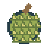

# 食品与饮料

[返回项目首页](../README.md) · [手册目录](README.md)

## 通用食用规则

食品、饮料按使用条件和效果分类，不以加入时间区分。每个条目依次列出名称与标识、获取方式、效果与数值、操作方式、消耗与限制。箱内生成概率在每个自然箱子生成时判定一次，不因开箱刷新；详见[战利品生成](world.md#战利品生成)。部分常见食品也能由[普通小怪独立掉落](combat.md#普通小怪的食品掉落)，与箱内生成无关。

食品必须先放到物品栏并选中，长按左键0.5秒；手机长按场景或“使用”。当前饥饿≤10才可吃，完整增加食品数值，因此可以超过10；超过10后不能继续吃。需要火的食品要求已点燃篝火的曼哈顿距离1～3格。倒地仍可吃，松开、换物品、开面板或断线会取消未完成使用。食品不可堆叠，每次吃掉1件。

状态饮料不属于补充饥饿的食品，不受饥饿禁食门槛限制。体温、饥饿与状态计时见[生存规则](survival.md)；篝火的点燃与供暖见[设施手册](machines.md#篝火)。

## 即食食品

### 奥利奥

- **名称与标识**：奥利奥 / Oreos / `oreos`。
- **获取方式**：自然箱子的食品组有30%概率生成1～5份食品，本物品从该组等概率抽选；普通小怪死亡时独立10%概率掉1份食品，食品种类按[掉落表](combat.md#普通小怪的食品掉落)抽选。
- **效果与数值**：恢复 1.5 点饥饿；完整加值，可超过10。
- **操作方式**：放入物品栏并选中，长按左键或手机“使用”0.5秒；无需篝火。
- **消耗与限制**：每次消耗1件；当前饥饿大于10时不能吃。

### 压缩饼干

- **名称与标识**：压缩饼干 / Compressed biscuits / `compressed_biscuits`。
- **获取方式**：自然箱子的食品组有30%概率生成1～5份食品，本物品从该组等概率抽选；普通小怪死亡时独立10%概率掉1份食品，食品种类按[掉落表](combat.md#普通小怪的食品掉落)抽选。
- **效果与数值**：恢复 4 点饥饿；完整加值，可超过10。
- **操作方式**：放入物品栏并选中，长按左键或手机“使用”0.5秒；无需篝火。
- **消耗与限制**：每次消耗1件；当前饥饿大于10时不能吃。

### 可乐

- **名称与标识**：可乐 / Cola / `cola`。
- **获取方式**：自然箱子的食品组有30%概率生成1～5份食品，本物品从该组等概率抽选；普通小怪死亡时独立10%概率掉1份食品，食品种类按[掉落表](combat.md#普通小怪的食品掉落)抽选；也可在[自动售货机](machines.md#自动售货机)兑换，完整价格见设施条目。
- **效果与数值**：恢复 2 点饥饿；完整加值，可超过10。
- **操作方式**：放入物品栏并选中，长按左键或手机“使用”0.5秒；无需篝火。
- **消耗与限制**：每次消耗1件；当前饥饿大于10时不能吃。

### 榴莲

- **名称与标识**：榴莲 / Durian / `durian`。
- **获取方式**：每个自然房屋箱子独立 3% 概率生成1件。
- **效果与数值**：恢复 3 点饥饿；完整加值，可超过10。吃完后在原格留下1个[榴莲皮](weapons.md#榴莲皮)，即使其余格子全满也能产出。
- **操作方式**：放入物品栏并选中，长按左键或手机“使用”0.5秒；无需篝火。
- **消耗与限制**：每次消耗1件；当前饥饿大于10时不能吃。榴莲消耗、饥饿增加和榴莲皮产出一起保存，失败整次回退。

### 巧克力

- **名称与标识**：巧克力 / Chocolate bar / `chocolate_bar`。
- **获取方式**：每个自然房屋箱子独立 1.8% 概率生成1件；也可在[自动口粮机](machines.md#自动口粮机)兑换，完整价格见设施条目。
- **效果与数值**：恢复 2 点饥饿；完整加值，可超过10。
- **操作方式**：放入物品栏并选中，长按左键或手机“使用”0.5秒；无需篝火。
- **消耗与限制**：每次消耗1件；当前饥饿大于10时不能吃。

### 能量棒

- **名称与标识**：能量棒 / Energy bar / `energy_bar`。
- **获取方式**：每个自然房屋箱子独立 1.2% 概率生成1件。
- **效果与数值**：恢复 3 点饥饿；完整加值，可超过10。
- **操作方式**：放入物品栏并选中，长按左键或手机“使用”0.5秒；无需篝火。
- **消耗与限制**：每次消耗1件；当前饥饿大于10时不能吃。

### 花生米

- **名称与标识**：花生米 / Roasted peanuts / `peanut_pack`。
- **获取方式**：每个自然房屋箱子独立 1.5% 概率生成1件。
- **效果与数值**：恢复 2.5 点饥饿；完整加值，可超过10。
- **操作方式**：放入物品栏并选中，长按左键或手机“使用”0.5秒；无需篝火。
- **消耗与限制**：每次消耗1件；当前饥饿大于10时不能吃。

### 芒果干

- **名称与标识**：芒果干 / Dried mango / `dried_mango`。
- **获取方式**：每个自然房屋箱子独立 1.8% 概率生成1件。
- **效果与数值**：恢复 1.5 点饥饿；完整加值，可超过10。
- **操作方式**：放入物品栏并选中，长按左键或手机“使用”0.5秒；无需篝火。
- **消耗与限制**：每次消耗1件；当前饥饿大于10时不能吃。

### 牛肉干

- **名称与标识**：牛肉干 / Beef jerky / `beef_jerky`。
- **获取方式**：每个自然房屋箱子独立 1% 概率生成1件；也可在[自助食品脱水机](machines.md#自助食品脱水机)兑换，完整价格见设施条目。
- **效果与数值**：恢复 3.5 点饥饿；完整加值，可超过10。
- **操作方式**：放入物品栏并选中，长按左键或手机“使用”0.5秒；无需篝火。
- **消耗与限制**：每次消耗1件；当前饥饿大于10时不能吃。

### 黄桃罐头

- **名称与标识**：黄桃罐头 / Canned peaches / `canned_peaches`。
- **获取方式**：每个自然房屋箱子独立 1.5% 概率生成1件。
- **效果与数值**：恢复 2 点饥饿；完整加值，可超过10。
- **操作方式**：放入物品栏并选中，长按左键或手机“使用”0.5秒；无需篝火。
- **消耗与限制**：每次消耗1件；当前饥饿大于10时不能吃。

### 焗豆罐头

- **名称与标识**：焗豆罐头 / Canned beans / `canned_beans`。
- **获取方式**：每个自然房屋箱子独立 1% 概率生成1件。
- **效果与数值**：恢复 3.5 点饥饿；完整加值，可超过10。
- **操作方式**：放入物品栏并选中，长按左键或手机“使用”0.5秒；无需篝火。
- **消耗与限制**：每次消耗1件；当前饥饿大于10时不能吃。

### 玉米罐头

- **名称与标识**：玉米罐头 / Canned corn / `canned_corn`。
- **获取方式**：每个自然房屋箱子独立 1.5% 概率生成1件。
- **效果与数值**：恢复 2.5 点饥饿；完整加值，可超过10。
- **操作方式**：放入物品栏并选中，长按左键或手机“使用”0.5秒；无需篝火。
- **消耗与限制**：每次消耗1件；当前饥饿大于10时不能吃。

### 菠萝罐头

- **名称与标识**：菠萝罐头 / Canned pineapple / `canned_pineapple`。
- **获取方式**：每个自然房屋箱子独立 1.6% 概率生成1件。
- **效果与数值**：恢复 2 点饥饿；完整加值，可超过10。
- **操作方式**：放入物品栏并选中，长按左键或手机“使用”0.5秒；无需篝火。
- **消耗与限制**：每次消耗1件；当前饥饿大于10时不能吃。

### 芝麻饼

- **名称与标识**：芝麻饼 / Sesame biscuit / `sesame_biscuit`。
- **获取方式**：每个自然房屋箱子独立 1.8% 概率生成1件。
- **效果与数值**：恢复 2 点饥饿；完整加值，可超过10。
- **操作方式**：放入物品栏并选中，长按左键或手机“使用”0.5秒；无需篝火。
- **消耗与限制**：每次消耗1件；当前饥饿大于10时不能吃。

### 米饼

- **名称与标识**：米饼 / Rice cracker / `rice_cracker`。
- **获取方式**：每个自然房屋箱子独立 2% 概率生成1件。
- **效果与数值**：恢复 1 点饥饿；完整加值，可超过10。
- **操作方式**：放入物品栏并选中，长按左键或手机“使用”0.5秒；无需篝火。
- **消耗与限制**：每次消耗1件；当前饥饿大于10时不能吃。

### 蜂蜜包

- **名称与标识**：蜂蜜包 / Honey sachet / `honey_sachet`。
- **获取方式**：每个自然房屋箱子独立 1.8% 概率生成1件。
- **效果与数值**：恢复 1.5 点饥饿；完整加值，可超过10。
- **操作方式**：放入物品栏并选中，长按左键或手机“使用”0.5秒；无需篝火。
- **消耗与限制**：每次消耗1件；当前饥饿大于10时不能吃。

### 混合坚果

- **名称与标识**：混合坚果 / Mixed nuts / `mixed_nuts`。
- **获取方式**：每个自然房屋箱子独立 1.2% 概率生成1件；也可在[自动口粮机](machines.md#自动口粮机)兑换，完整价格见设施条目。
- **效果与数值**：恢复 3 点饥饿；完整加值，可超过10。
- **操作方式**：放入物品栏并选中，长按左键或手机“使用”0.5秒；无需篝火。
- **消耗与限制**：每次消耗1件；当前饥饿大于10时不能吃。

### 海苔卷

- **名称与标识**：海苔卷 / Seaweed roll / `seaweed_roll`。
- **获取方式**：每个自然房屋箱子独立 1.7% 概率生成1件。
- **效果与数值**：恢复 1.5 点饥饿；完整加值，可超过10。
- **操作方式**：放入物品栏并选中，长按左键或手机“使用”0.5秒；无需篝火。
- **消耗与限制**：每次消耗1件；当前饥饿大于10时不能吃。

### 小鱼干

- **名称与标识**：小鱼干 / Dried fish / `dried_fish`。
- **获取方式**：每个自然房屋箱子独立 1.2% 概率生成1件；也可在[自助食品脱水机](machines.md#自助食品脱水机)兑换，完整价格见设施条目。
- **效果与数值**：恢复 2.5 点饥饿；完整加值，可超过10。
- **操作方式**：放入物品栏并选中，长按左键或手机“使用”0.5秒；无需篝火。
- **消耗与限制**：每次消耗1件；当前饥饿大于10时不能吃。

## 需火食品

### 方便面

- **名称与标识**：方便面 / Instant noodles / `instant_noodles`。
- **获取方式**：自然箱子的食品组有30%概率生成1～5份食品，本物品从该组等概率抽选；普通小怪死亡时独立10%概率掉1份食品，食品种类按[掉落表](combat.md#普通小怪的食品掉落)抽选。
- **效果与数值**：恢复 2.5 点饥饿；完整加值，可超过10。
- **操作方式**：放入物品栏并选中，长按左键或手机“使用”0.5秒；必须在已点燃篝火的曼哈顿距离1～3格内。
- **消耗与限制**：每次消耗1件；当前饥饿大于10时不能吃。

### 速冻饺子

- **名称与标识**：速冻饺子 / Frozen dumplings / `dumplings`。
- **获取方式**：自然箱子的食品组有30%概率生成1～5份食品，本物品从该组等概率抽选。
- **效果与数值**：恢复 4 点饥饿；完整加值，可超过10。
- **操作方式**：放入物品栏并选中，长按左键或手机“使用”0.5秒；必须在已点燃篝火的曼哈顿距离1～3格内。
- **消耗与限制**：每次消耗1件；当前饥饿大于10时不能吃。

### 速冻馄饨

- **名称与标识**：速冻馄饨 / Frozen wontons / `wontons`。
- **获取方式**：自然箱子的食品组有30%概率生成1～5份食品，本物品从该组等概率抽选。
- **效果与数值**：恢复 3 点饥饿；完整加值，可超过10。
- **操作方式**：放入物品栏并选中，长按左键或手机“使用”0.5秒；必须在已点燃篝火的曼哈顿距离1～3格内。
- **消耗与限制**：每次消耗1件；当前饥饿大于10时不能吃。

### 冷冻猪蹄

- **名称与标识**：冷冻猪蹄 / Frozen pork trotters / `pork_trotters`。
- **获取方式**：自然箱子的食品组有30%概率生成1～5份食品，本物品从该组等概率抽选。
- **效果与数值**：恢复 4 点饥饿；完整加值，可超过10。
- **操作方式**：放入物品栏并选中，长按左键或手机“使用”0.5秒；必须在已点燃篝火的曼哈顿距离1～3格内。
- **消耗与限制**：每次消耗1件；当前饥饿大于10时不能吃。

### 冷冻牛肉

- **名称与标识**：冷冻牛肉 / Frozen beef / `beef`。
- **获取方式**：自然箱子的食品组有30%概率生成1～5份食品，本物品从该组等概率抽选。
- **效果与数值**：恢复 5 点饥饿；完整加值，可超过10。
- **操作方式**：放入物品栏并选中，长按左键或手机“使用”0.5秒；必须在已点燃篝火的曼哈顿距离1～3格内。
- **消耗与限制**：每次消耗1件；当前饥饿大于10时不能吃。

### 冷冻羊肉

- **名称与标识**：冷冻羊肉 / Frozen lamb / `lamb`。
- **获取方式**：自然箱子的食品组有30%概率生成1～5份食品，本物品从该组等概率抽选。
- **效果与数值**：恢复 5 点饥饿；完整加值，可超过10。
- **操作方式**：放入物品栏并选中，长按左键或手机“使用”0.5秒；必须在已点燃篝火的曼哈顿距离1～3格内。
- **消耗与限制**：每次消耗1件；当前饥饿大于10时不能吃。

### 沙丁鱼罐头

- **名称与标识**：沙丁鱼罐头 / Canned sardines / `sardines`。
- **获取方式**：自然箱子的食品组有30%概率生成1～5份食品，本物品从该组等概率抽选；普通小怪死亡时独立10%概率掉1份食品，食品种类按[掉落表](combat.md#普通小怪的食品掉落)抽选。
- **效果与数值**：恢复 3 点饥饿；完整加值，可超过10。
- **操作方式**：放入物品栏并选中，长按左键或手机“使用”0.5秒；必须在已点燃篝火的曼哈顿距离1～3格内。
- **消耗与限制**：每次消耗1件；当前饥饿大于10时不能吃。

### 金枪鱼罐头

- **名称与标识**：金枪鱼罐头 / Canned tuna / `tuna`。
- **获取方式**：自然箱子的食品组有30%概率生成1～5份食品，本物品从该组等概率抽选。
- **效果与数值**：恢复 3 点饥饿；完整加值，可超过10。
- **操作方式**：放入物品栏并选中，长按左键或手机“使用”0.5秒；必须在已点燃篝火的曼哈顿距离1～3格内。
- **消耗与限制**：每次消耗1件；当前饥饿大于10时不能吃。

### 撒尿牛丸

- **名称与标识**：撒尿牛丸 / Stuffed beef balls / `beef_balls`。
- **获取方式**：自然箱子的食品组有30%概率生成1～5份食品，本物品从该组等概率抽选。
- **效果与数值**：恢复 5 点饥饿；完整加值，可超过10。
- **操作方式**：放入物品栏并选中，长按左键或手机“使用”0.5秒；必须在已点燃篝火的曼哈顿距离1～3格内。
- **消耗与限制**：每次消耗1件；当前饥饿大于10时不能吃。

### 速冻火锅涮菜

- **名称与标识**：速冻火锅涮菜 / Frozen hotpot vegetables / `hotpot_vegetables`。
- **获取方式**：自然箱子的食品组有30%概率生成1～5份食品，本物品从该组等概率抽选。
- **效果与数值**：恢复 2 点饥饿；完整加值，可超过10。
- **操作方式**：放入物品栏并选中，长按左键或手机“使用”0.5秒；必须在已点燃篝火的曼哈顿距离1～3格内。
- **消耗与限制**：每次消耗1件；当前饥饿大于10时不能吃。

### 冷冻披萨

- **名称与标识**：冷冻披萨 / Frozen pizza / `frozen_pizza`。
- **获取方式**：每个自然房屋箱子独立 0.6% 概率生成1件。
- **效果与数值**：恢复 5 点饥饿；完整加值，可超过10。
- **操作方式**：放入物品栏并选中，长按左键或手机“使用”0.5秒；必须在已点燃篝火的曼哈顿距离1～3格内。
- **消耗与限制**：每次消耗1件；当前饥饿大于10时不能吃。

### 咖喱饭

- **名称与标识**：咖喱饭 / Curry rice / `curry_rice`。
- **获取方式**：每个自然房屋箱子独立 0.5% 概率生成1件。
- **效果与数值**：恢复 5.5 点饥饿；完整加值，可超过10。
- **操作方式**：放入物品栏并选中，长按左键或手机“使用”0.5秒；必须在已点燃篝火的曼哈顿距离1～3格内。
- **消耗与限制**：每次消耗1件；当前饥饿大于10时不能吃。

### 燕麦粥

- **名称与标识**：燕麦粥 / Oatmeal / `oatmeal`。
- **获取方式**：每个自然房屋箱子独立 0.8% 概率生成1件；也可在[自动口粮机](machines.md#自动口粮机)兑换，完整价格见设施条目。
- **效果与数值**：恢复 4.5 点饥饿；完整加值，可超过10。
- **操作方式**：放入物品栏并选中，长按左键或手机“使用”0.5秒；必须在已点燃篝火的曼哈顿距离1～3格内。
- **消耗与限制**：每次消耗1件；当前饥饿大于10时不能吃。

### 蘑菇汤

- **名称与标识**：蘑菇汤 / Mushroom soup / `mushroom_soup`。
- **获取方式**：每个自然房屋箱子独立 0.9% 概率生成1件。
- **效果与数值**：恢复 4 点饥饿；完整加值，可超过10。
- **操作方式**：放入物品栏并选中，长按左键或手机“使用”0.5秒；必须在已点燃篝火的曼哈顿距离1～3格内。
- **消耗与限制**：每次消耗1件；当前饥饿大于10时不能吃。

### 八宝粽

- **名称与标识**：八宝粽 / Festival rice dumpling / `festival_dumpling`。
- **获取方式**：每个自然房屋箱子独立 0.3% 概率生成1件。
- **效果与数值**：恢复 6 点饥饿；完整加值，可超过10。
- **操作方式**：放入物品栏并选中，长按左键或手机“使用”0.5秒；必须在已点燃篝火的曼哈顿距离1～3格内。
- **消耗与限制**：每次消耗1件；当前饥饿大于10时不能吃。

## 状态饮料

### 伏特加

- **名称与标识**：伏特加 / Vodka / `vodka`。
- **获取方式**：每个自然房屋箱子独立 2% 概率生成1件。
- **效果与数值**：饮用后30秒处于亢奋，体感温度恒为30°C，按每现实分钟20°C回复体温，30秒最多恢复10°C；不直接补满、不增加饥饿。
- **操作方式**：放入物品栏并选中，长按左键或手机“使用”0.5秒；无需篝火，倒地及饥饿大于10时可用。
- **消耗与限制**：一次性；再次饮用刷新为30秒，不累加。保暖装备不再额外提高亢奋时的体感温度；离线与停机暂停个人状态计时。
