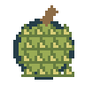

# 食品与饮料

[返回项目首页](../../README.md) · [手册目录](../README.md) · [本组目录](README.md)

## 通用食用规则

食品、饮料按使用条件和效果分类，不以加入时间区分。每个条目依次列出名称与标识、获取方式、效果与数值、操作方式、消耗与限制。箱内生成概率在每个自然箱子生成时判定一次，不因开箱刷新；详见[战利品生成](../world/world.md#战利品生成)。部分常见食品也能由[普通小怪独立掉落](../world/combat.md#普通小怪的食品掉落)，与箱内生成无关。

食品必须先放到物品栏并选中，长按左键0.5秒；手机长按场景或“使用”。食品最多把饱食度补到 10；满值时不会消耗食物。需要火的食品要求已点燃篝火的曼哈顿距离1～3格。倒地仍可吃，松开、换物品、开面板或断线会取消未完成使用。食品不可堆叠，每次吃掉1件。

状态饮料不属于补充饥饿的食品，不受饥饿禁食门槛限制。体温、饥饿与状态计时见[生存规则](../world/survival.md)；篝火的点燃与供暖见[设施手册](../building/machines.md#篝火)。

## 即食食品

### 奥利奥

- **名称与标识**：奥利奥 / Oreos / `oreos`。
- **获取方式**：每口普通自然箱有 10% 概率出现（1 件）；普通小怪死亡时独立10%概率掉1份食品，食品种类按[掉落表](../world/combat.md#普通小怪的食品掉落)抽选。
- **效果与数值**：恢复至多 1.5 点饱食度，上限 10。
- **操作方式**：放入物品栏并选中，长按左键或手机“使用”0.5秒；无需篝火。
- **消耗与限制**：成功食用消耗 1 件。

### 压缩饼干

- **名称与标识**：压缩饼干 / Compressed biscuits / `compressed_biscuits`。
- **获取方式**：每口普通自然箱有 8% 概率出现（1 件）；普通小怪死亡时独立10%概率掉1份食品，食品种类按[掉落表](../world/combat.md#普通小怪的食品掉落)抽选。
- **效果与数值**：恢复至多 4 点饱食度，上限 10。
- **操作方式**：放入物品栏并选中，长按左键或手机“使用”0.5秒；无需篝火。
- **消耗与限制**：成功食用消耗 1 件。

### 可乐

- **名称与标识**：可乐 / Cola / `cola`。
- **获取方式**：每口普通自然箱有 8% 概率出现（1 件）；普通小怪死亡时独立10%概率掉1份食品，食品种类按[掉落表](../world/combat.md#普通小怪的食品掉落)抽选；也可在[自动售货机](../building/machines.md#自动售货机)兑换，完整价格见设施条目。
- **效果与数值**：恢复至多 2 点饱食度，上限 10。
- **操作方式**：放入物品栏并选中，长按左键或手机“使用”0.5秒；无需篝火。
- **消耗与限制**：成功食用消耗 1 件。

### 榴莲

- **名称与标识**：榴莲 / Durian / `durian`。
- **获取方式**：每口普通自然箱有 3% 概率出现（1 件）。
- **效果与数值**：恢复至多 3 点饱食度，上限 10。吃完后在原格留下1个[榴莲皮](weapons.md#榴莲皮)，即使其余格子全满也能产出。
- **操作方式**：放入物品栏并选中，长按左键或手机“使用”0.5秒；无需篝火。
- **消耗与限制**：成功食用消耗 1 件。榴莲消耗、饥饿增加和榴莲皮产出一起保存，失败整次回退。

### 巧克力

- **名称与标识**：巧克力 / Chocolate bar / `chocolate_bar`。
- **获取方式**：每口普通自然箱有 5% 概率出现（1 件）；也可在[自动口粮机](../building/machines.md#自动口粮机)兑换，完整价格见设施条目。
- **效果与数值**：恢复至多 2 点饱食度，上限 10。
- **操作方式**：放入物品栏并选中，长按左键或手机“使用”0.5秒；无需篝火。
- **消耗与限制**：成功食用消耗 1 件。

### 牛肉干

- **名称与标识**：牛肉干 / Beef jerky / `beef_jerky`。
- **获取方式**：也可在[自助食品脱水机](../building/machines.md#自助食品脱水机)兑换，完整价格见设施条目。
- **效果与数值**：恢复至多 3.5 点饱食度，上限 10。
- **操作方式**：放入物品栏并选中，长按左键或手机“使用”0.5秒；无需篝火。
- **消耗与限制**：成功食用消耗 1 件。

### 混合坚果

- **名称与标识**：混合坚果 / Mixed nuts / `mixed_nuts`。
- **获取方式**：每口普通自然箱有 6% 概率出现（1 件）；也可在[自动口粮机](../building/machines.md#自动口粮机)兑换，完整价格见设施条目。
- **效果与数值**：恢复至多 3 点饱食度，上限 10。
- **操作方式**：放入物品栏并选中，长按左键或手机“使用”0.5秒；无需篝火。
- **消耗与限制**：成功食用消耗 1 件。

### 小鱼干

- **名称与标识**：小鱼干 / Dried fish / `dried_fish`。
- **获取方式**：也可在[自助食品脱水机](../building/machines.md#自助食品脱水机)兑换，完整价格见设施条目。
- **效果与数值**：恢复至多 2.5 点饱食度，上限 10。
- **操作方式**：放入物品栏并选中，长按左键或手机“使用”0.5秒；无需篝火。
- **消耗与限制**：成功食用消耗 1 件。

## 需火食品

### 方便面

- **名称与标识**：方便面 / Instant noodles / `instant_noodles`。
- **获取方式**：每口普通自然箱有 10% 概率出现（1 件）；普通小怪死亡时独立10%概率掉1份食品，食品种类按[掉落表](../world/combat.md#普通小怪的食品掉落)抽选。
- **效果与数值**：恢复至多 2.5 点饱食度，上限 10。
- **操作方式**：放入物品栏并选中，长按左键或手机“使用”0.5秒；必须在已点燃篝火的曼哈顿距离1～3格内。
- **消耗与限制**：成功食用消耗 1 件。

### 速冻饺子

- **名称与标识**：速冻饺子 / Frozen dumplings / `dumplings`。
- **获取方式**：每口普通自然箱有 12% 概率出现（1 件）。
- **效果与数值**：恢复至多 4 点饱食度，上限 10。
- **操作方式**：放入物品栏并选中，长按左键或手机“使用”0.5秒；必须在已点燃篝火的曼哈顿距离1～3格内。
- **消耗与限制**：成功食用消耗 1 件。

### 冷冻牛肉

- **名称与标识**：冷冻牛肉 / Frozen beef / `beef`。
- **获取方式**：每口普通自然箱有 12% 概率出现（1 件）。
- **效果与数值**：恢复至多 5 点饱食度，上限 10。
- **操作方式**：放入物品栏并选中，长按左键或手机“使用”0.5秒；必须在已点燃篝火的曼哈顿距离1～3格内。
- **消耗与限制**：成功食用消耗 1 件。

### 沙丁鱼罐头

- **名称与标识**：沙丁鱼罐头 / Canned sardines / `sardines`。
- **获取方式**：每口普通自然箱有 10% 概率出现（1 件）；普通小怪死亡时独立10%概率掉1份食品，食品种类按[掉落表](../world/combat.md#普通小怪的食品掉落)抽选。
- **效果与数值**：恢复至多 3 点饱食度，上限 10。
- **操作方式**：放入物品栏并选中，长按左键或手机“使用”0.5秒；必须在已点燃篝火的曼哈顿距离1～3格内。
- **消耗与限制**：成功食用消耗 1 件。

### 燕麦粥

- **名称与标识**：燕麦粥 / Oatmeal / `oatmeal`。
- **获取方式**：也可在[自动口粮机](../building/machines.md#自动口粮机)兑换，完整价格见设施条目。
- **效果与数值**：恢复至多 4.5 点饱食度，上限 10。
- **操作方式**：放入物品栏并选中，长按左键或手机“使用”0.5秒；必须在已点燃篝火的曼哈顿距离1～3格内。
- **消耗与限制**：成功食用消耗 1 件。

### 八宝粽

- **名称与标识**：八宝粽 / Festival rice dumpling / `festival_dumpling`。
- **获取方式**：每口普通自然箱有 1% 概率出现（1 件）。
- **效果与数值**：恢复至多 6 点饱食度，上限 10。
- **操作方式**：放入物品栏并选中，长按左键或手机“使用”0.5秒；必须在已点燃篝火的曼哈顿距离1～3格内。
- **消耗与限制**：成功食用消耗 1 件。

## 状态饮料

### 伏特加

- **名称与标识**：伏特加 / Vodka / `vodka`。
- **获取方式**：每口普通自然箱有 2% 概率出现（1 件）。
- **效果与数值**：饮用后30秒处于亢奋，通常体感温度恒为30°C，按每现实分钟15°C回复体温，30秒最多恢复7.5°C；不直接补满、不增加饥饿。
- **操作方式**：放入物品栏并选中，长按左键或手机“使用”0.5秒；无需篝火，倒地及满饱食时可用。
- **消耗与限制**：一次性；再次饮用刷新为30秒，不累加。保暖装备不再额外提高亢奋时的体感温度；不能抵消饥饿≤1时高于18°C的强制降温，详见生存规则。离线与停机暂停个人状态计时。
