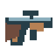
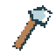
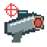
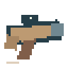

# 武器手册

[返回项目首页](../README.md) · [手册目录](README.md) · [怪物与战斗规则](combat.md)

本手册集中介绍全部武器的立绘、获取方式、攻击范围、伤害、冷却、弹药或次数限制与操作。怪物生成、寻路、昼夜行为与攻击玩家规则见[怪物与战斗](combat.md)；手机操作见[界面与操作](controls.md)。

## 基础枪械

自然房屋箱子有10%的独立枪械判定，成功后按手枪70%、霰弹枪20%、步枪10%选择一把，即每箱分别为7%、2%、1%；不会替换其他独立掉落。也可在[自动枪械机](trading.md#自动枪械机)分别花3、5、10金币购买一把满弹药枪。

玩家未失温倒地并选中枪械后，朝鼠标对应的世界坐标瞄准。手枪、霰弹枪和追踪导弹每次按下鼠标左键尝试开一枪，长按不会自动连发；步枪按下左键时尝试开第一枪，保持按住时由服务器按冷却间隔持续连发，不依赖客户端点击频率。松开左键、切换物品、打开界面、窗口失焦、失温倒地或掉线时立即停止连发，之后需要重新按下左键才能开始。

服务器按下表执行最短射击间隔和射速上限，每名玩家每个 tick 最多结算一次枪械射击。冷却内的额外射击请求直接丢弃，不消耗子弹、不排队补射；卡顿后也不能一次补发多枪。切换物品不能清除已经产生的射击冷却。表中速度使用世界坐标单位，秒均为世界运行时累计的现实时间；三种枪械均不再使用原有固定射程。

| 武器 | 初始子弹数 | 最短射击间隔 | 射速上限 | 子弹速度 | 消失距离 | 单次射击 |
| --- | --- | --- | --- | --- | --- | --- |
|  手枪 | 100 | 0.25s | 每秒 4 发 | 每秒 20 格 | 玩家视野半对角线 | 1 枚子弹，命中每只怪物造成 5 点伤害 |
|  霰弹枪 | 200 | 0.8s | 每秒 1.25 发 | 每秒 18 格 | 玩家视野半对角线 | 消耗 1 发弹药，在瞄准方向正负 12 度内均匀发射 5 枚弹丸，每枚对每只怪物造成 2 点伤害 |
|  步枪 | 1000 | 0.15s | 约每秒 6.67 发，以最短射击间隔为准 | 每秒 28 格 | 玩家视野半对角线 | 1 枚子弹，命中每只怪物造成 5 点伤害 |

霰弹枪的一次射击对同一怪物最多造成 10 点伤害，近距离全部弹丸命中时可以一枪击倒小怪；中远距离会因散布降低命中弹丸数。手枪适合精准单点，霰弹枪适合近距离爆发，步枪适合持续输出。以上三种枪械不需要装填，也不能补充子弹；每次成功射击消耗一发弹药，霰弹枪的五枚弹丸合计只消耗一发。最后一发射出后枪械立即从物品栏中消失，但已经射出的子弹继续飞行。子弹从射手位置发出，忽略射手自身，可以穿过木墙和柱子，并沿弹道依次贯穿多个可命中的角色；穿透不衰减伤害，每枚弹丸对同一目标至多伤害一次，停留在目标碰撞箱内或重启后再次相交都不会重复伤害。霰弹枪的五枚弹丸分别判定对怪物的伤害，对同一玩家仍每次射击最多伤害一次。树木仍挡住双方子弹；箱子、篝火（无论燃烧或熄灭）、小猪存钱罐和全部交易机器只挡怪物子弹，玩家子弹可以穿透这些建筑；服务器逐段检查弹道，只命中阻挡物之前且消失距离以内的目标，不因单个 tick 跨过目标而漏判。

玩家子弹以发射者当前坐标为圆心，当欧氏距离超过其当前游戏视野对角线长度的一半时消失，替代旧的固定射程。距离上限为 `sqrt(视野宽² + 视野高²) / 2`，电脑 32×18 格视野下约为 18.36 格；手机使用当前横竖屏实际画布尺寸除以世界缩放比例，转屏、浏览器缩放或窗口尺寸改变后更新，已有子弹也使用新上限。圆心跟随该玩家移动，不使用发射时的位置，也不按累计飞行路程计算。多玩家分别使用各自视野，旁观者的屏幕不改变别人的子弹。发射者离线时沿用其最后位置和视野；全员离线时子弹仍暂停。命中记录、距离参考和旧存档兼容缺省值一并保存，不重建地图。

## 斧头

斧头 `axe` 不消耗耐久，可反复使用；攻击和采集是两种不同操作，攻击必须遵守下述冷却，不能靠连点绕过。

玩家未失温倒地、选中斧头时，朝空地或怪物单击左键立即挥斧，无需长按；即使按下和松开都发生在同一个 tick 之间，也不会丢失这次点击。以玩家中心为圆心，攻击点击方向前方半径 3 格的 **180° 半圆扇形**内所有可见怪物，每只造成 4 点伤害并分别结算击退。令朝点击位置的向量为 a，朝怪物中心的向量为 b，距离不超过 3 格且 a·b ≥ 0（夹角不超过 90°，包含两侧边界）时处于攻击范围；仍保留障碍物遮挡视线的限制，不隔墙砍怪。点击位置仅决定方向，不限制被命中怪物的数量，也不要求点击命中怪物。

每次挥斧播放标明半圆范围的弧形刃光和两段刀风声，空挥同样播放并消耗 0.5s 冷却；冷却内的点击直接丢弃，不排队补打。点击与玩家完全重合、体温不足或冷却未结束时不挥斧。按住不放不会自动重复攻击，切换目标或物品也不能重置冷却。斧头不伤害其他玩家。砍树和拆除方块仍须持续长按，松开或切换目标即清空拆除进度；普通点击结构仍优先交互/开始采集，不触发扇形攻击，攻击怪物不累计拆除进度。

## 通用命中与反馈

玩家子弹可以伤害其他玩家，每次有效射击命中同一玩家时，该玩家损失 1 点体温和 1 点饥饿值。霰弹枪同一次射击的多个弹丸命中同一玩家，也只结算一次上述损失。

桌面和手机的本机挥斧动画、刀风声立即响应点击，不等待服务器回包；八方向六帧 PNG 已预渲染斧头与刃光，确认后不重复播放。视觉朝向取最近的八方向，命中扇形仍严格按点击向量计算。预览不改变怪物血量、击退或掉落；拒绝、掉线、保存失败会取消尚未结束的预览。

实际命中时由服务器沿攻击方向结算击退：斧头击退怪物 0.7 格，玩家子弹击退怪物 0.4 格；大怪承受上述距离的 60%。小怪近战击退玩家 0.65 格，大怪近战为 1 格，怪物子弹为 0.9 格，其他玩家子弹为 0.3 格。霰弹枪对同一怪物的多个弹丸分别结算伤害，但一次射击只击退、播放命中声一次；对同一玩家也只击退一次。击退逐段检查障碍物与角色碰撞，不穿墙、不进入未生成区域；被挡住时仍正常受伤。受击会打断正在累计的交互进度，不额外增加眩晕、不修改攻速与移动速度。

## 寒冰法杖

`ice_staff` 是有限次数的近战武器。每个自然房屋箱子独立有 2% 概率生成一根满 **100 次**的寒冰法杖，无制作配方；旧世界仅在尚未生成的区域使用新掉落规则。它与斧头使用完全相同的单击操作、半径 **3 格、180° 前方半圆**群攻、视线要求和 **0.5 秒**冷却，但每只命中怪物受到 **8 点伤害**，即斧头的两倍；击退距离与斧头一致，不伤害玩家，也不能代替斧头采集或拆除。

每次有效挥动消耗 1 次，无论空挥还是命中多少只怪物都只扣一次；第 100 次仍完整结算伤害，然后法杖消失。冷却内、倒地、窗口打开、朝向无效或点击不可攻击的结构时不消耗次数、不播放成功挥动；按住不连续攻击。斧头与寒冰法杖共享近战冷却，切换物品不能绕过射速限制。

命中的活动怪物在接下来 **4 个现实秒**内冰冻：移动速度为自身正常速度的 **50%**，普通小怪与大怪从 1.2 降到 0.6 格/秒，快速怪从 4.8 降到 2.4 格/秒。追击和游荡均减速，大怪同时不能发射新的远程子弹，但仍可近战或拆墙；先前已经发射的子弹不受影响。重复命中刷新至最后一次命中后的 4 秒，不叠加减速倍数；到期自动恢复。计时随世界运行，全员离线或服务器停止时暂停，保存重启不会补满或丢失剩余时间。

白天休眠的大怪与快速怪仍有正常血量，可以被斧头、法杖和子弹攻击，击杀后使用各自正常金币掉落概率。寒冰法杖攻击休眠或正在起立的怪物时只造成伤害，不新增或刷新冰冻，也不唤醒它们；休眠立绘优先，不绘制蓝色冰冻姿态。普通小怪全天活动，白天仍可冰冻。

活动中的冰冻小怪、大怪与快速怪各有独立偏蓝色、带冰晶的 PNG，以及上、下、左、右的站立与跑动差分。挥杖沿用斧头的六帧弧形轨迹、范围显示和刀风音效，独立预烘焙八方向寒冰法杖与刃光；本机点击立即播放，服务器确认后不重复播放。冻结和解冻不重建运动轨迹，逐帧仅切换贴图，不实时调色、绘制粒子或重新计算扇形。

## 烈焰法杖

烈焰法杖（`flame_staff`）在自然箱子中独立以 **2%** 概率生成，初始 **100 次**，与寒冰法杖相同，每次有效挥动消耗 1 次，空挥也计次，多目标仍只计一次，第 100 次完整结算后消失。不能制作或代替斧头拆除建筑。单击操作、3 格半径、180° 前方半圆、视线要求、0.5 秒共享近战冷却、直接伤害 **4 点**和直接命中的击退均与斧头一致；八方向六帧挥杖刃光为暖色独立 PNG，本机即时播放刀风与动画。

命中的怪物灼烧 **4 秒**，首次持续伤害在命中 **0.5 秒后**发生，之后每 **0.5 秒**造成 **4 点伤害**，包含第 4 秒的最后一次，总计 8 次、32 点持续伤害。灼烧伤害**没有击退，不打断寻路或拆除**，不按每次跳伤害叠加声音或命中动画；死亡仍播放正常音效、动画并结算正常掉落。每只灼烧怪物叠加同一套小火苗 PNG 动画，不新增整套立绘或运行时粒子系统。

再次命中刷新到最后一次命中后 4 秒，不叠加伤害频率，不重置尚未到来的下一次跳伤害；新命中的法杖玩家作为灼烧来源。冰冻和灼烧可以共存。白天休眠的大怪和快速怪也会受直接伤害并继续灼烧，火苗可叠加在休眠立绘上，但不会因此提前醒来。最后一名玩家离线或服务器停止时暂停计时；重启保留剩余时长、下一次跳伤害时间、来源和法杖次数，不补算离线伤害。

## 手榴弹与金币榴弹炮

 

手榴弹（`grenade`）为一次性物品，可在自动枪械机花 **5 金币**购买，或在自然箱子中独立以 **2%** 概率生成。桌面手持后瞄准位置，**长按左键 0.5 秒**投掷；手机先点场景或用瞄准摇杆选落点，再长按“使用”0.5 秒。松开、换物品、开面板、失温倒地、失去输入或断线都会中断尚未完成的蓄力，不扣物品。瞄准点须在已生成区域且距玩家不超过当前视野半对角线，墙和其他方块不阻挡投掷，也可瞄准有建筑的格子。

投掷成功即消耗一枚，手榴弹用 **0.45 秒**的抛物线飞向发射瞬间锁定的坐标，到达后爆炸。以落点为圆心，**欧氏距离小于等于 3 格**的所有怪物分别受到 **20 点伤害（斧头单击的 5 倍）**；不检查墙体遮挡，不伤害任何玩家（包括自己），不破坏任何方块，也不造成击退。怪物按爆炸时的位置判定，休眠怪物同样可受伤、死亡和正常掉落。一次爆炸仅播放一段半径对应的独立 PNG 爆炸动画和一次爆炸音效，不按命中数量重复创建效果。

金币榴弹炮（`coin_launcher`）也在自动枪械机出售，暂定购买价 **10 金币**。它没有子弹数、不装弹、不随发射消失；必须有至少 **1 金币**才可使用。先长按 **0.5 秒**发射，持续按住最多**每秒 1 发**，每次成功发射恰好扣 **1 金币**。余额耗尽后停止发射，必须松开再长按才可重新开始。每发都向当前瞄准坐标投出一枚与手榴弹完全相同的投射物，飞行、爆炸动画、范围和伤害结算一致，绝不伤玩家或建筑。

两种爆炸武器与普通枪械共享 `next_shot` 冷却，不能换武器绕过冷却。金币扣除或手榴弹消耗、在途投射物与保存原子提交；爆炸时的全部怪物伤害、死亡、掉落、随机状态和投射物移除也一起提交。保存失败全部回滚，不产生成功事件。重启保留已经投出的手榴弹及其剩余飞行时间，全员离线时冻结，不重复爆炸。

## 追踪导弹

追踪导弹 `homing_missile` 在自然房屋箱子中独立有 **2%** 概率生成，初始 **20发**，每发基础伤害 **15**（手枪的三倍）。与霰弹枪共用最短 **0.8秒** 射击间隔，每名玩家每tick最多射击一次；切换武器不能绕过冷却。选中后单击左键发射，手机瞄准后点“使用”，长按不连发，第20发后武器消失，不能装填。

每发在实际射出的瞬间按射手与怪物的欧氏距离锁定最近的存活怪物，包含白天休眠的大怪/快速怪；等距时按怪物ID稳定选取。点击位置只决定最初方向，不决定目标，点击附近箱子也会发射而不是打开箱子；瞄准射手自身时改朝锁定目标发射，双方重合则向右发射。没有怪物时不扣弹药，也不产生冷却。

导弹从玩家坐标出发，先用0.12秒沿点击方向飞行1.2格，再沿平滑曲线追向锁定目标的当前位置；飞行总时长为 `max(0.45秒, 发射时距离 / 18 + 0.12秒)`。弹道仅作飞行表现，不进行沿途碰撞：可穿过所有方块、玩家和其他怪物，也不受普通子弹的视野半对角线限制。它不会改换目标；锁定目标在命中前死亡或被移除时，导弹直接消失，不爆炸、不伤害其他对象。

到达时只对锁定目标结算一次15点伤害及普通子弹击退，并播放画幅1.8格的小型爆炸（手榴弹爆炸画幅6格）。这不是范围伤害，不会伤害玩家、其他怪物或方块；警长徽章照常将对小怪/快速怪的伤害翻倍至30。弹药、锁定和在途导弹随存档保存，全员离线时飞行暂停；命中、击杀、掉落与导弹移除原子提交，保存失败不会重复命中或丢弹。

服务端只在发射时选择最近目标，飞行中按ID查目标，既不逐帧索敌，也不扫描沿途方块或其他怪物。客户端按时间和已平滑的目标位置计算常数规模曲线，选择预烘焙八方向PNG；爆炸复用已加载的六帧图集及限流音效，不新增逐帧粒子系统或全地图同步。

## 警长徽章

警长徽章（`sheriff_badge`）在每个新自然房屋箱子中独立以2%概率出现。放在30格背包或10格物品栏任意位置即被动生效，无需选中，也不消耗次数。携带多个不叠加；放在地上、箱子或火堆不生效。

所有武器对**普通小怪与快速怪**的伤害乘二：包括斧头、寒冰/烈焰法杖直伤，三种枪械的每颗子弹、手榴弹/金币榴弹炮爆炸，以及由该玩家施加的每次灼烧。伤害实际结算时检查攻击者当前携带的徽章，因此弹丸命中或灼烧跳伤前取下徽章不再加成；拾起后则生效。例：斧头4→8、寒冰法杖8→16、灼烧每跳4→8、爆炸20→40。

不增加对大怪或其他玩家的伤害，不改变击退、范围、射速、弹药消耗、冰冻/灼烧持续时间或金币概率；快速怪仍保留原有2.5倍受击击退。白天休眠快速怪也按同一伤害规则处理。

## 榴莲皮

榴莲皮 `durian_peel` 由[食用榴莲](expansion.md#榴莲与榴莲皮)后在原物品栏格子中获得，不占额外产出格。长按0.5秒投向已探索、视野半对角线以内的落点，抛物线飞行0.45秒后爆炸；伤害与手榴弹相同，半径3格内怪物受20伤害，不伤玩家、方块，无额外范围击退。使用一次消失，不能当食品吃；手机可直接长按落点，或瞄准后按住“使用”。

## 二十种扩展武器

新增8种有限弹药枪械、6种有限次数近战、6种一次性投掷物，完整参数及立绘见本节下表。枪械可有冰冻/灼烧弹、可配置弹丸散布和自动模式，但仍受射击冷却、每tick一枪及正常穿透/友伤约束；新枪按下即尝试首发，极短点击/手机点按不会在下一tick前丢失。

近战按各自半径和扇形角度结算，不再假设所有武器都是180度。各自有独立六帧与八方向PNG；所有有效空挥也扣次数，冷却内点击不扣。工兵铲有较强击退；冰霜/电击沿用减速与大怪禁射，火系沿用每0.5秒4伤害，无重复状态叠加。

新范围武器共享冰霜/火焰/脉冲爆炸PNG，避免逐怪额外立绘或粒子。

| 名称 / English / ID | 独立概率 | 效果 | 操作 |
| --- | --- | --- | --- |
|  老式左轮 / Old revolver / `rust_revolver` | 1% | 初始24发，每弹丸伤害7，每枪1弹丸，间隔0.5秒。 | 选中后单击发射一枪，长按不连发；手机使用按钮同理。耗尽消失，不能装填。普通子弹穿透规则及误伤规则不变。 |
|  袖珍手枪 / Pocket pistol / `compact_pistol` | 1.4% | 初始60发，每弹丸伤害5，每枪1弹丸，间隔0.2秒。 | 选中后单击发射一枪，长按不连发；手机使用按钮同理。耗尽消失，不能装填。普通子弹穿透规则及误伤规则不变。 |
|  猎人步枪 / Hunting rifle / `hunting_rifle` | 0.6% | 初始18发，每弹丸伤害12，每枪1弹丸，间隔0.95秒。 | 选中后单击发射一枪，长按不连发；手机使用按钮同理。耗尽消失，不能装填。普通子弹穿透规则及误伤规则不变。 |
|  双管猎枪 / Double-barrel shotgun / `double_barrel` | 0.8% | 初始24发，每弹丸伤害3，每枪4弹丸，间隔1.1秒。 | 选中后单击发射一枪，长按不连发；手机使用按钮同理。耗尽消失，不能装填。普通子弹穿透规则及误伤规则不变。 |
|  射钉枪 / Nail gun / `nail_gun` | 1.2% | 初始90发，每弹丸伤害2，每枪3弹丸，间隔0.18秒。 | 选中后按住连续射击；手机使用按钮同理。耗尽消失，不能装填。普通子弹穿透规则及误伤规则不变。 |
|  冰晶卡宾枪 / Ice carbine / `ice_carbine` | 0.4% | 初始24发，每弹丸伤害4，每枪1弹丸，间隔0.65秒。 活动怪物冰冻2秒、速度减半，大怪不能射击；休眠怪物只受伤。 | 选中后单击发射一枪，长按不连发；手机使用按钮同理。耗尽消失，不能装填。普通子弹穿透规则及误伤规则不变。 |
|  余烬手枪 / Ember pistol / `ember_pistol` | 0.3% | 初始16发，每弹丸伤害3，每枪1弹丸，间隔0.8秒。 灼烧1.5秒，每0.5秒伤害4，无持续击退；同类状态不叠加，只延长。 | 选中后单击发射一枪，长按不连发；手机使用按钮同理。耗尽消失，不能装填。普通子弹穿透规则及误伤规则不变。 |
|  暴风冲锋枪 / Storm SMG / `storm_smg` | 0.2% | 初始160发，每弹丸伤害4，每枪1弹丸，间隔0.1秒。 | 选中后按住连续射击；手机使用按钮同理。耗尽消失，不能装填。普通子弹穿透规则及误伤规则不变。 |
|  撬棍 / Crowbar / `crowbar` | 1.8% | 初始60次，伤害5，半径2.4格，正前方120度扇形，间隔0.6秒。 | 单击空地或怪物挥动，手机瞄准后点使用；每次有效挥动含空挥消耗一次，耗尽消失。不能拆建筑，不可长按连攻。 |
|  开山刀 / Machete / `machete` | 1.2% | 初始80次，伤害5，半径2.7格，正前方180度扇形，间隔0.55秒。 | 单击空地或怪物挥动，手机瞄准后点使用；每次有效挥动含空挥消耗一次，耗尽消失。不能拆建筑，不可长按连攻。 |
|  工兵铲 / Snow shovel / `snow_shovel` | 1.5% | 初始50次，伤害3，半径3.4格，正前方180度扇形，间隔0.75秒。 | 单击空地或怪物挥动，手机瞄准后点使用；每次有效挥动含空挥消耗一次，耗尽消失。不能拆建筑，不可长按连攻。 |
|  电击棍 / Shock baton / `shock_baton` | 0.6% | 初始40次，伤害6，半径2格，正前方120度扇形，间隔0.7秒。 活动怪物冰冻1.5秒、速度减半，大怪不能射击；休眠怪物只受伤。 | 单击空地或怪物挥动，手机瞄准后点使用；每次有效挥动含空挥消耗一次，耗尽消失。不能拆建筑，不可长按连攻。 |
|  寒霜长矛 / Frost spear / `frost_spear` | 0.4% | 初始40次，伤害7，半径4格，正前方70度扇形，间隔0.9秒。 活动怪物冰冻2秒、速度减半，大怪不能射击；休眠怪物只受伤。 | 单击空地或怪物挥动，手机瞄准后点使用；每次有效挥动含空挥消耗一次，耗尽消失。不能拆建筑，不可长按连攻。 |
|  火焰鞭 / Fire whip / `fire_whip` | 0.3% | 初始35次，伤害3，半径3.6格，正前方140度扇形，间隔0.8秒。 灼烧2秒，每0.5秒伤害4，无持续击退；同类状态不叠加，只延长。 | 单击空地或怪物挥动，手机瞄准后点使用；每次有效挥动含空挥消耗一次，耗尽消失。不能拆建筑，不可长按连攻。 |
|  铁罐炸弹 / Tin bomb / `tin_bomb` | 1.5% | 一次性；爆炸半径2.2格，伤害12，只伤怪物，不伤玩家或建筑。 | 选中后朝落点长按0.6秒投掷；手机可长按场景，或瞄准后按住使用。落点须已探索且在视野半对角线内，用后消失。 |
|  冰霜弹 / Frost bomb / `frost_bomb` | 0.6% | 一次性；爆炸半径2.5格，伤害8，只伤怪物，不伤玩家或建筑。 活动怪物冰冻3秒、速度减半，大怪不能射击；休眠怪物只受伤。 | 选中后朝落点长按0.5秒投掷；手机可长按场景，或瞄准后按住使用。落点须已探索且在视野半对角线内，用后消失。 |
|  燃烧瓶 / Fire bottle / `fire_bottle` | 0.8% | 一次性；爆炸半径2.5格，伤害4，只伤怪物，不伤玩家或建筑。 灼烧2秒，每0.5秒伤害4，无持续击退；同类状态不叠加，只延长。 | 选中后朝落点长按0.5秒投掷；手机可长按场景，或瞄准后按住使用。落点须已探索且在视野半对角线内，用后消失。 |
|  破片炸药 / Fragmentation charge / `cluster_charge` | 0.4% | 一次性；爆炸半径2格，伤害24，只伤怪物，不伤玩家或建筑。 | 选中后朝落点长按1秒投掷；手机可长按场景，或瞄准后按住使用。落点须已探索且在视野半对角线内，用后消失。 |
|  脉冲手雷 / Pulse grenade / `pulse_grenade` | 0.3% | 一次性；爆炸半径3.5格，伤害10，只伤怪物，不伤玩家或建筑。 活动怪物冰冻1.5秒、速度减半，大怪不能射击；休眠怪物只受伤。 | 选中后朝落点长按0.5秒投掷；手机可长按场景，或瞄准后按住使用。落点须已探索且在视野半对角线内，用后消失。 |
|  信号爆弹 / Flare bomb / `flare_bomb` | 1% | 一次性；爆炸半径3格，伤害8，只伤怪物，不伤玩家或建筑。 灼烧1秒，每0.5秒伤害4，无持续击退；同类状态不叠加，只延长。 | 选中后朝落点长按0.5秒投掷；手机可长按场景，或瞄准后按住使用。落点须已探索且在视野半对角线内，用后消失。 |

## 开发与存档

群攻用一次距离平方和点积筛选，先确定命中集合再处理击退；一次挥斧仅发送一次攻击特效/播放一次刀风，不为每个目标复制刃光。休眠怪物不参加寻路，起立使用图集和时间进度，不新增持续粒子或逐怪广播；唤醒后仍遵守现有寻路预算。

所有有限武器的剩余弹药或使用次数、在途攻击和命中记录均随原子存档保存；旧存档使用既有缺省值，不重建已生成区块。客户端的预烘焙PNG、声音与即时预测只负责表现，服务端负责实际伤害与次数结算，拒绝或保存失败会纠正预览。各物品独立PNG见本页表格；动画及生成脚本见[美术资源](assets.md)。
